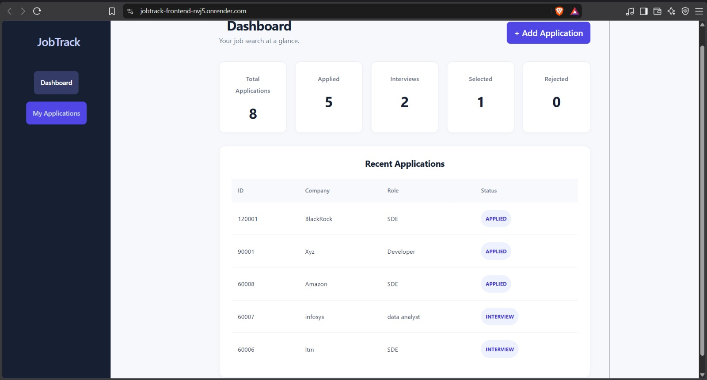
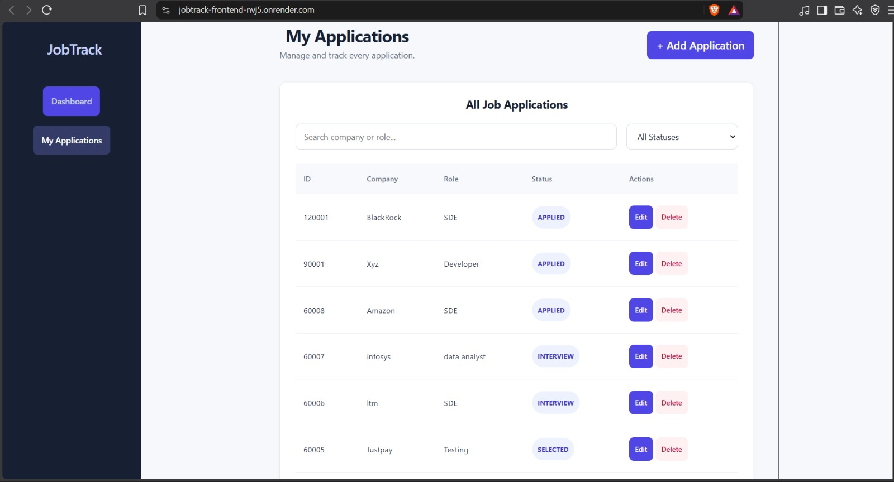

# JobTrack — Job Application Tracker

JobTrack is a full-stack web application that helps job seekers manage and track their job applications in one place.

## Live Demo

- **Frontend:** https://jobtrack-frontend-nvj5.onrender.com
- **Backend API:** https://jobtrack-backend-t7zg.onrender.com/api/jobs

## Features

- Add new job applications.
- View all saved applications.
- Edit existing application details.
- Delete applications.
- Track application statuses: Applied, Interview, Selected, and Rejected.
- View dashboard statistics for application statuses.
- Search and filter applications.
- Store application data in a cloud database.

## Tech Stack

### Frontend
- React
- Vite
- JavaScript
- CSS

### Backend
- Java
- Spring Boot
- Spring Data JPA
- Maven
- REST APIs
- Docker — containerizing the Spring Boot backend

### Database and Deployment
- TiDB Cloud (MySQL-compatible database)
- Render (frontend and backend hosting)
- Git and GitHub

## System Architecture

JobTrack uses a frontend-backend architecture.

- **Frontend:** React and Vite provide the user interface and are hosted on Render.
- **Backend:** Spring Boot and Java 21 expose REST APIs for managing job applications.
- **Containerization:** Docker uses a multi-stage build to package the backend application.
- **Database:** TiDB Cloud stores job application records using a MySQL-compatible database.
- **Configuration:** Environment variables manage database connection settings.

The frontend communicates with the backend through REST APIs, while the backend interacts with the database to store and retrieve application data.

### Architecture Flow

```text
User
  |
  v
React + Vite Frontend (Render)
  |
  | HTTP / REST API
  v
Spring Boot Backend (Docker on Render)
  |
  | JDBC / MySQL-compatible connection
  v
TiDB Cloud Database
```

## Screenshots

### Dashboard



### My Applications



## API Endpoints

| Method | Endpoint | Description |
|---|---|---|
| GET | `/api/jobs` | Retrieve all job applications |
| POST | `/api/jobs` | Create a job application |
| GET | `/api/jobs/{id}` | Retrieve an application by ID |
| PUT | `/api/jobs/{id}` | Update an application |
| DELETE | `/api/jobs/{id}` | Delete an application |


## Run Locally

### Prerequisites

- Java 21
- Maven
- Node.js and npm
- A MySQL-compatible database
- Git

### 1. Clone the repository

```bash
git clone https://github.com/thrinesh01/JobTrack.git
cd JobTrack
```

### 2. Configure the backend

Configure the following environment variables in your IDE's run configuration or shell:

```text
DB_URL=your_database_jdbc_url
DB_USERNAME=your_database_username
DB_PASSWORD=your_database_password
```

Use your own database connection details. 

### 3. Run the Spring Boot backend

Open a terminal in the `backend` directory and run:

```bash
mvn spring-boot:run
```

The backend normally runs on `http://localhost:8080`.

### 4. Run the React frontend

Open another terminal in the `frontend` directory and run:

```bash
npm install
npm run dev
```

Open the local URL printed by Vite in your terminal, usually `http://localhost:5173`.

Ensure the frontend API configuration points to your local backend when running locally.

## Security

- Database credentials are supplied through environment variables.
- Do not commit passwords, API keys, or other secrets.
- Use environment variables for deployment-specific configuration.

## Docker and Deployment

- Created a multi-stage `Dockerfile` using Maven and Java 21 to build the Spring Boot backend into a JAR file.
- Used a Java 21 runtime container to run the packaged backend application.
- Deployed the containerized backend to Render.
- Configured database credentials through Render environment variables for secure database connectivity.

  

## Future Improvements

- User authentication and individual application tracking.
- Application deadlines and interview reminders.
- Notes and interview preparation tracking.
- Improved analytics and reporting.
- Automated testing and CI/CD.

## Author - Thrinesh

Developed as a minor full-stack project to gain hands on experience with React, Java, Spring Boot, REST API development, database integration, and cloud deployment.
